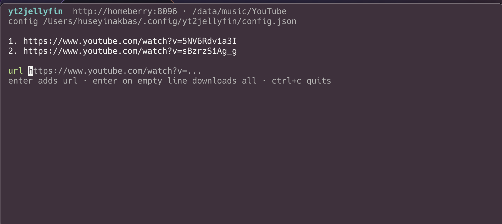
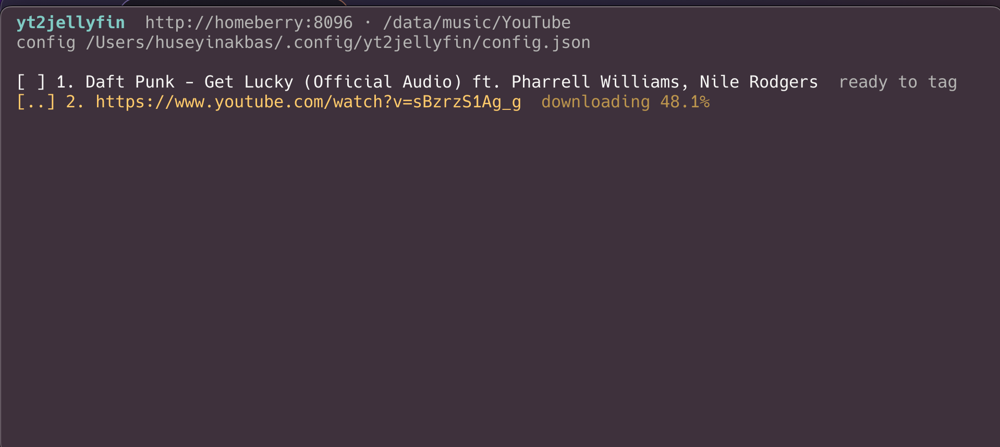
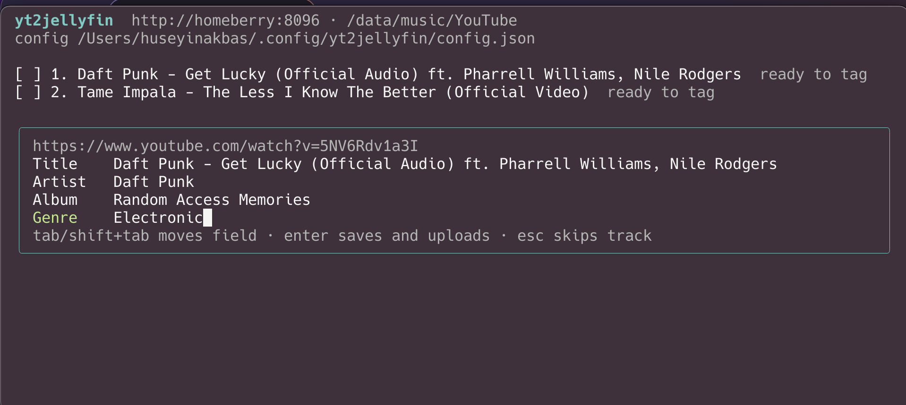
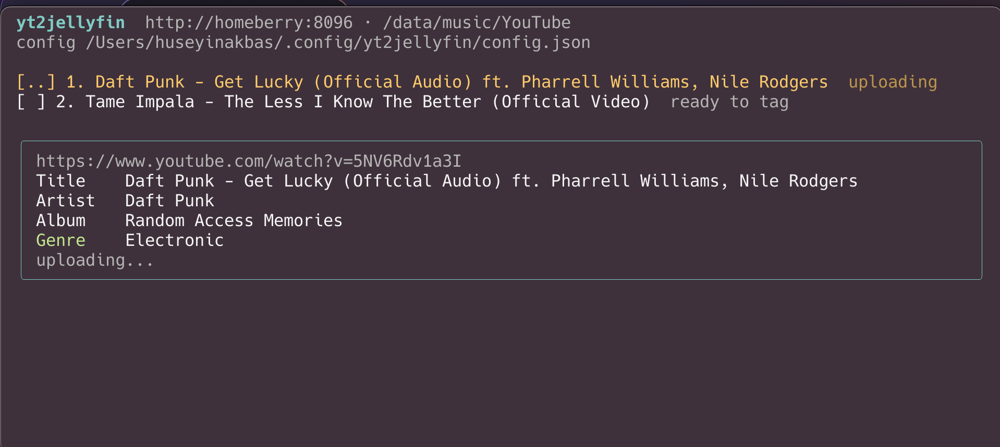
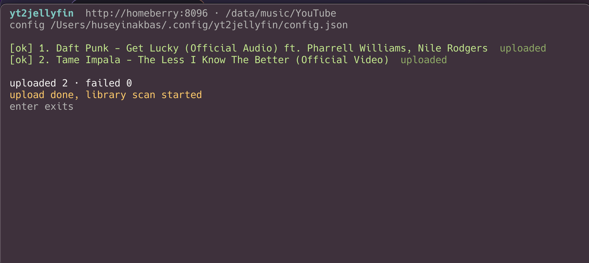

# yt2jellyfin

TUI: paste YouTube urls, download as MP3, fix title/artist/album/genre, upload to the Jellyfin music library, refresh the library.

## Screenshots

Paste the urls:



Downloads run one at a time with yt-dlp progress:



Each track opens a tag box, prefilled from yt-dlp metadata:



`enter` on the last field tags and uploads through the plugin:



When the queue empties the library refresh is triggered:



## Install

```sh
npm i -g yt2jellyfin
yt2jellyfin
```

## Requirements

- node >= 22, pnpm
- `yt-dlp`, `ffmpeg` on PATH
- the [RemoteUpload plugin](https://github.com/grandguyjs/media-upload-plugin) on the Jellyfin server
- Jellyfin API key (Dashboard / API Keys, admin, needed for plugin upload + refresh)

## From source

```sh
pnpm install
pnpm dev
# or
pnpm build && node dist/index.js
```

First run opens a setup screen with prefilled defaults (jellyfin url, upload dir, yt-dlp/ffmpeg paths); enter through the fields and it writes the config. A missing or broken config file shows the same screen again.

Flow: `enter` adds a url, `enter` on an empty line downloads all, then each track opens a review box. `tab`/`shift+tab` move between fields, `enter` on the last field saves tags and uploads, `esc` skips. When the queue empties the library refresh is triggered.

## Config

Asked in the TUI on first run, saved to `~/.config/yt2jellyfin/config.json` (mode 600). Values below are the defaults the setup screen prefills.

```json
{
  "jellyfinUrl": "http://media.example.com:8096",
  "jellyfinApiKey": "",
  "jellyfinUploadDir": "/data/music/YouTube",
  "downloadDir": "~/Music/yt2jellyfin",
  "ytDlpPath": "yt-dlp",
  "ffmpegPath": "ffmpeg"
}
```

Env overrides: `YTJ_JELLYFIN_URL`, `YTJ_JELLYFIN_API_KEY`, `YTJ_JELLYFIN_UPLOAD_DIR`, `YTJ_DOWNLOAD_DIR`, `YTJ_YTDLP`, `YTJ_FFMPEG`.

Uploads are chunked through the plugin API into `jellyfinUploadDir` (server-side path inside the Jellyfin music library; the app sets the plugin's upload dir to it). Files never need ssh/scp.
